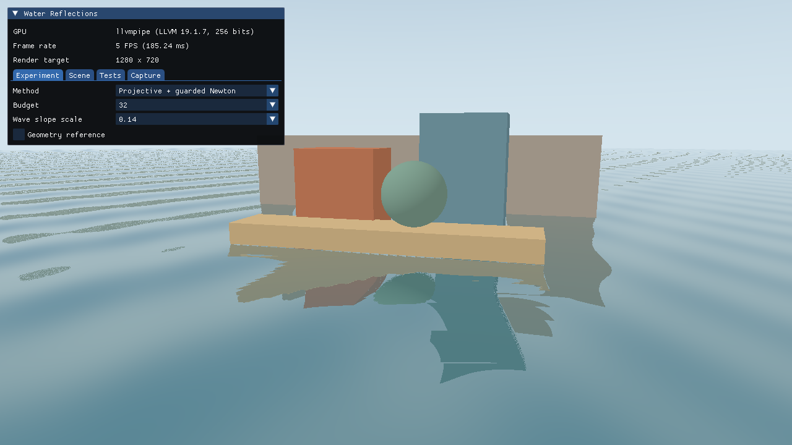
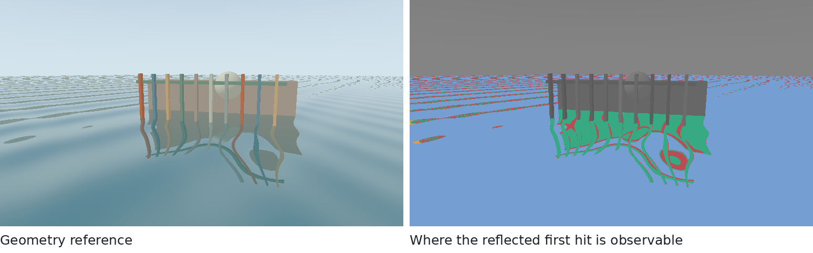
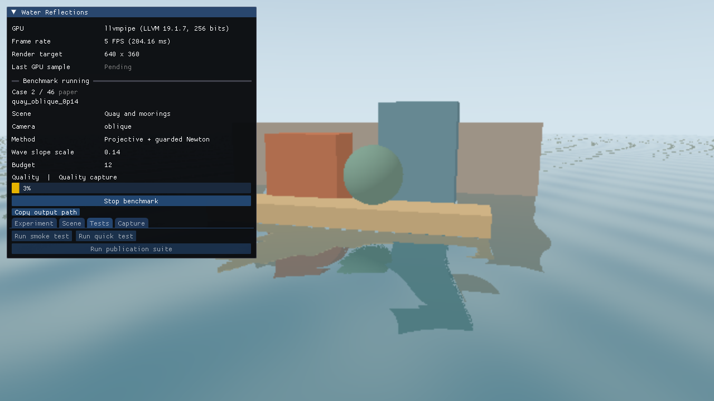

# gfx-research-water-reflections

[](https://en.cppreference.com/w/cpp/20)
[](https://www.opengl.org/)
[](https://cmake.org/)

An OpenGL experiment on recovering the first object hit by a reflected ray in screen space. At a quay, a ray can pass a thin piling and return the wall behind it. The color may look plausible even when the reflection comes from the wrong object.

The renderer compares bisection, secant and tangent-plane Newton updates on a shared coarse traversal. An independent intersection with the entire scene provides the first object, ray distance and reflected radiance. A tilted polished panel tests whether the same solver transfers to a second surface.



*The viewer opens on `quay` with `guarded-newton`, 32 coarse steps and wave slope scale 0.14. The screenshot was captured with software OpenGL.*

[Method](#method) · [Scenes](#scenes) · [Pilot results](#pilot-results) · [Build](#build) · [Controls](#controls) · [Live benchmark preview](#live-benchmark-preview) · [Experiments](#experiments) · [References](#references)

## Highlights

- Five methods expose the effect of world-distance stepping, projected stepping, the initial guess and refinement.
- Three solvers use identical projected samples, acceptance tolerances and a four-update refinement budget.
- The geometric reference distinguishes observable first hits, hidden geometry, off-screen hits and rays that reach the environment.
- The runner records correct object identity, hit distance, linear RGB error, depth probes and fallback counts alongside images and GPU timing.

## Method

Let $O$ be the ray origin, $d$ its unit reflected direction, and $P,N$ the position and normal sampled from the primary camera buffer. Intersecting the ray with the local tangent plane gives the proposal

```math
t_{\mathrm{plane}}=\frac{N\cdot(P-O)}{N\cdot d},\qquad X(t)=O+td.
```

The coarse traversal clips the ray to the view frustum. It accepts a sample directly when the view-depth residual is within tolerance. Otherwise the first transition from a negative to a nonnegative residual brackets a candidate hit. The guarded solver uses the valid endpoint with the smaller absolute residual. It takes the midpoint if the tangent is almost parallel to the ray ($|N\cdot d|<0.002$), the proposal is nonfinite, or it falls outside the bracket interior. The code allows up to four refinements.

| Method ID | Traversal | Refinement |
|---|---|---|
| `uniform-bisect` | Uniform distances along the clipped world ray | Bisection |
| `projective-bisect` | Uniform fractions of the projected segment | Bisection, primary comparator |
| `projective-secant` | Same projected traversal | Guarded secant, midpoint fallback |
| `guarded-newton` | Same projected traversal | Guarded tangent-plane update, midpoint fallback |
| `free-newton` | Single seed at 35% of the projected segment | Up to six unbracketed updates |

The projected traversal interpolates ray distance with perspective correction and a fixed step budget. Long rays can skip pixels. A depth discontinuity can also create a false bracket. Once the traversal passes a foreground piling, even a precise intersection with the wall behind it gives the wrong first hit. The reference checks object identity and ray distance to catch this case.

## Scenes

| Scene ID | Geometry | What it tests |
|---|---|---|
| `quay` | Buildings, quay, sphere and rear wall | Broad planar and curved targets |
| `pilings` | Narrow vertical posts and a crossbar in front of a wall | Skipped foreground hits |
| `occluded-bank` | Layered shore geometry | Hidden surfaces and hits outside the view |
| `tilted-metal` | Finite inclined polished panel | Transfer to a planar non-water reflector |
| `empty-sky` | Reflecting water with no reflected target | All receiver pixels should return the shared environment |



*The right panel marks observable geometry in green, in-frame unresolved geometry in red, off-screen geometry in orange and the environment in blue. Gray marks pixels outside the reflecting surface.*

## Pilot results

The image-quality pilot used Mesa llvmpipe, 320 × 180 pixels, 32 coarse steps and wave slope scale 0.14. The three water scenes contribute three cameras each. The table reports arithmetic means over those nine views. The polished panel is a separate transfer test in the full suite.

| Method | Observable first-hit recall ↑ | Wrong accepted hits per receiver ↓ | Linear RGB RMSE ↓ |
|---|---:|---:|---:|
| `projective-bisect` | 92.939% | 2.383% | 0.06613 |
| `projective-secant` | 92.195% | 2.165% | 0.07102 |
| `guarded-newton` | 93.617% | 2.370% | 0.06619 |

Guarded Newton recovered an additional 0.68 percentage points of observable first hits relative to bisection. Both produced nearly the same aggregate RGB error, with a slightly lower RMSE for bisection. The secant variant had the lowest rate of wrong hits among these three. These measurements cover static quality on the listed scenes. [Per-view measurements](docs/pilot/views.csv) · [Pilot script](docs/pilot/measure.py)

### Research question

At the same coarse budget, does guarded Newton increase observable first-hit recall while limiting the increase in wrong hits per receiver to 0.005? The primary comparison uses `projective-bisect`, 32 steps and slope 0.14. A correct observable hit must identify the reference object and match its ray distance to within the per-hit tolerance.

Mayer, Assarsson and Sintorn derived the tangent-plane Newton step for refraction and caustics and explicitly suggested extending it to reflected rays. The bracketed comparison measures what that adaptation buys. A stronger publication project would classify coarse-traversal failures separately from refinement failures, then test whether a discontinuity check can recover skipped near hits at a fixed GPU cost against pixel DDA or hierarchical traversal. The current five methods provide controls for that extension. [References](#references)

## Build

The native viewer requires a C++20 compiler, CMake 3.25+, a desktop OpenGL 4.6 Core driver and Python 3.10+ with `venv` and `pip`. Use 64-bit Python for an x64 build. The first CMake configuration creates a private environment in the build directory and installs the packages in `requirements.txt`. Both GLAD and the publication runner use this interpreter. The headless renderer uses desktop OpenGL 4.3 and the same effect shader as the viewer.

**CLion on Windows.** Open the project, select Release, reload CMake and build the executable. Run it and choose **Tests → Run smoke test**. The first configuration fetches the base and Python packages. CMake builds the viewer library next to the executable. The viewer and the benchmark use the private interpreter recorded in the build directory.

**Windows, PowerShell and Ninja**

```powershell
cmake -S . -B out/build -G Ninja -DCMAKE_BUILD_TYPE=Release
cmake --build out/build --parallel
ctest --test-dir out/build --output-on-failure
.\out\build\gfx-research-water-reflections.exe
```

**Linux, Bash and Ninja**

```bash
cmake -S . -B out/build -G Ninja -DCMAKE_BUILD_TYPE=Release
cmake --build out/build --parallel
ctest --test-dir out/build --output-on-failure
./out/build/gfx-research-water-reflections
```

For a local base checkout, append `-DGFX_RESEARCH_BASE_LOCAL_PATH=../gfx-research-base` to the configure command. To select a specific base Python installation, pass its absolute interpreter path as `-DPython3_EXECUTABLE=...`. With multi-configuration generators, build with `--config Release` and use the executable in `out/build/Release`. The viewer loads shader sources from the configured source directory.

## Controls

| Tab or shortcut | Action |
|---|---|
| **Experiment** | Choose the solver, 12 or 32 coarse steps, and wave slope scale 0 or 0.14. Toggle **Geometry reference** for comparison. |
| **Scene** | Choose a scene and a camera (`oblique`, `reverse`, `grazing`). Switch between **Shaded scene**, **Effect only** and **Traversal work**. |
| **Tests** | Start **Run smoke test**, **Run quick test** or **Run publication suite**. The current benchmark frame appears in the same window. |
| **Stop benchmark** / **Resume benchmark** | Stop after the current rendering or export step. Resume rechecks committed cases and repeats the unfinished case. |
| **Copy output path** | Copy the absolute path of the current or most recent suite. |
| **Capture** / `F9` | Save a clean PNG while exploring the scene. Capture also offers the suite buttons. |
| `F1` or `Ctrl+H` / `Ctrl+F` | Hide or show the panel / toggle fullscreen. |
| `--capture DIRECTORY` | Render the default view, save one clean PNG to the directory and exit. |

`F9` saves under `captures/` in the launch directory. Filenames identify scene, camera, method, budget, parameter and display mode. Suites launched from the panel write to `results/publication/<profile>-<timestamp>/` inside the project.

## Experiments

### Live benchmark preview



The window shows guarded Newton refinement at the quay with wave slope 0.14 and 12 coarse steps. This capture comes from the `paper` profile on Mesa llvmpipe. The panel identifies the case, camera, method, parameter, sampling budget and target resolution. During timing it also shows the last resolved GPU sample. The window scales the actual benchmark image to fit, preserving its aspect ratio. The PNGs collected for the paper use the test resolution and contain only the rendered image.

A run started in **Tests** returns to the interactive scene on completion or after a stop. A run started with a `--publication-*` profile opens the same window and exits on completion. Closing that window or pressing **Stop benchmark** during a command-line run returns exit code 130. To resume after reopening the application, use the same profile and output directory with `--publication-resume`.

### Run a suite

From the `cmake-build-release` directory used by CLion on Windows, the executable accepts the same publication profile flags as `gfx-research-sky`. The examples put the data under the project root.

```powershell
.\gfx-research-water-reflections.exe --publication-smoke --publication-output=../results/publication/smoke
.\gfx-research-water-reflections.exe --publication-quick --publication-output=../results/publication/quick
.\gfx-research-water-reflections.exe --publication-suite --publication-output=../results/publication/paper
```

With no explicit output directory, the program creates a timestamped directory under the project's `results/publication/`. To resume an interrupted visual paper run in the directory used above, enter the following command.

```powershell
.\gfx-research-water-reflections.exe --publication-suite --publication-output=../results/publication/paper --publication-resume
```

For an unattended run without a window, use `--study run`. These commands print the plan and run it on a GPU matching the supplied renderer name.

```powershell
.\gfx-research-water-reflections.exe --study plan --profile paper
.\gfx-research-water-reflections.exe --study run --profile paper --out ../results/publication/rx9070xt --expect-renderer "9070 XT"
```

| Profile | Quality resolution | Timing resolution | Warm-up draws per block | Blocks × measured draws per method and condition |
|---|---|---|---:|---:|
| `smoke` | 144 × 80 | 144 × 80 | 2 | 1 × 3 |
| `quick` | 320 × 180 | 640 × 360 | 5 | 3 × 10 |
| `paper` | 640 × 360 | 1280 × 720 and 1920 × 1080 | 12 | 5 × 40 |

The `paper` matrix contains **22 quality cases, 220 method-and-budget evaluations and 24,000 timed draws**. The three water scenes use both slopes and three cameras. The polished panel uses a fixed normal, and the empty scene uses one camera. GPU timings cover the quay and pilings at slope 0.14.

`plan` prints the case matrix without opening a graphics context. With `run`, `--expect-renderer` checks a substring of the active renderer name. Set it to the target card, or omit it to accept the default adapter. Linux defaults to EGL and supports `--device INDEX`. Windows uses the default OpenGL context. Use `--hardware-note` for a driver or clock note. To continue an interrupted headless run, repeat the original command with `--resume`. It verifies completed cases and checks the plan, measurement source hash and device.

### Analyze results

Run these from `cmake-build-release`. To use the run created with `--publication-suite` in the example above, substitute `../results/publication/paper` for `../results/publication/rx9070xt`.

```powershell
.\gfx-research-water-reflections.exe --study analyze ../results/publication/rx9070xt
.\gfx-research-water-reflections.exe --study analyze ../results/publication/rx9070xt --paper ../../gfx-research-water-reflections-paper
```

The first command checks the captures against their hashes and recomputes quality metrics from the linear arrays. The second also imports the figure, LaTeX fragment and summary tables into the matching manuscript extracted alongside the project.

| Output in the run directory | Contents |
|---|---|
| `manifest.json` | Renderer, presentation mode, runtime versions, command, source hash, seed, exact case matrix and completion status |
| `quality/CASE/reference.npz` | Linear reflection RGB, first-hit ID and distance, observability class, match tolerance, primary positions, normals and masks |
| `quality/CASE/reference_scene.png`, `reference_signal.png`, `regions.png` | Shaded reference, isolated reference signal and metric masks |
| `quality/CASE/bBUDGET/METHOD/` | `scene.png`, `signal.png`, `error.png` and full-precision `raw.npz` with diagnostic channels |
| `timing/CASE/timing.csv` | Individual GPU elapsed times in nanoseconds with block, method order and sample index |
| `report/quality.csv`, `report/timing.csv` | All per-condition quality rows and raw timing samples |
| `report/paired_quality.csv`, `report/timing_blocks.csv`, `report/paired_timing.csv` | Paired quality differences, block medians and p95 timings, paired timing differences and intervals |
| `report/summary.json`, `report/comparison.png`, `report/results.tex` | Primary comparison, fixed comparison panel and manuscript fragment |

`visible_recall` divides correct first hits by observable geometric hits. Observability requires an in-frame match to the primary object ID and a position within $\max(0.03, 2w)$ of the true hit, where $w$ is the world-space pixel width there. `wrong_hits_per_receiver` divides accepted incorrect predictions by all reflecting pixels. `rgb_rmse` uses linear reflection radiance before water tint and Fresnel. White in `error.png` represents per-pixel RGB RMSE of 0.25 or greater. The linear arrays retain larger errors. Empty classes have zero pixels and a blank metric.

Each timing query encloses one effect draw with diagnostics disabled. Geometry, reference, readback, PNG encoding, preview composition and the interface are outside the query. Presentation can affect GPU scheduling between batches. Compare timings from the same presentation mode, case and block. The panel FPS includes the entire window update.

### Verify the reference and reproduce the pilot

From the project root, use the interpreter recorded by CMake. Set the build directory to the one you configured (`cmake-build-release` for the CLion examples or `out/build` for the Ninja examples).

```powershell
$studyPython = (Get-Content -Raw .\cmake-build-release\publication-python.txt).Trim()
& $studyPython tests/test_reference.py
& $studyPython docs/pilot/measure.py --out runs/pilot-views.csv
```

The reference check compares the GPU output with independent double-precision intersections on the default scene. The software-rendered smoke suite completed 25 method evaluations on five scenes, including the empty-environment control. The reference check verified 221 primary rays and 124 reflected rays. The pilot command reproduces the table's input using seed 17. It writes one row per scene, camera and method. The archived pilot contains image-quality data only. The `paper` profile is ready for a separate target-GPU run.

## Project structure

| Location | Responsibility |
|---|---|
| [study.json](study.json) | Shared scene and method IDs, budgets, candidate and baseline |
| [src/main.cpp](src/main.cpp) and [src/publication.cpp](src/publication.cpp) | Executable entry points and build-local interpreter selection |
| [src/viewer.cpp](src/viewer.cpp) and [tools/viewer.py](tools/viewer.py) | GLFW/ImGui panel, clean captures and live benchmark frames on the window's GL context |
| [cmake/PublicationPython.cmake](cmake/PublicationPython.cmake) | Prepare and verify the build-local publication environment |
| [shaders/effect.frag](shaders/effect.frag) | Clipping, depth brackets, projective stepping and root solvers |
| [shaders/reference.frag](shaders/reference.frag) | First intersection, radiance and observability class |
| [shaders/receiver.glsl](shaders/receiver.glsl) and [shaders/objects.glsl](shaders/objects.glsl) | Water and metal receiver rays and scene primitives |
| [tools/study.py](tools/study.py) and [tools/protocol.py](tools/protocol.py) | Suite execution, case matrix and recoverable runs |
| [tools/renderer.py](tools/renderer.py), [tools/metrics.py](tools/metrics.py) and [tools/report.py](tools/report.py) | Offscreen rendering, metrics, analysis and paper export |
| [tests/test_reference.py](tests/test_reference.py) | Independent geometric checks |

## References

1. Chase Mayer, Ulf Assarsson and Erik Sintorn. *Ultrafast Screen-Space Refractions and Caustics via Newton's Method*. JCGT 15(1), 44–59, 2026. Section 4 discusses reflection rays and initialization. Appendix A derives the tangent-plane update. [Paper](https://jcgt.org/published/0015/01/03/paper-lowres.pdf)
2. Morgan McGuire and Michael Mara. *Efficient GPU Screen-Space Ray Tracing*. JCGT 3(4), 73–85, 2014. Perspective-correct pixel DDA and multiple depth layers. [Paper](https://jcgt.org/published/0003/04/04/paper.pdf)
3. Tomasz Stachowiak. *Depth Buffer Raymarching for Contact Shadows, SSGI, SSR, etc.* 2023. Public implementation of depth traversal, bisection and optional secant refinement. [Source and notes](https://gist.github.com/h3r2tic/9c8356bdaefbe80b1a22ae0aaee192db)
4. Nikolai Hofmann, Phillip Bogendörfer, Marc Stamminger and Kai Selgrad. *Hierarchical Multi-Layer Screen-Space Ray Tracing*. High Performance Graphics, 2017. A reference for testing alternative traversal and visibility representations. [Paper](https://doi.org/10.1145/3105762.3105781)
